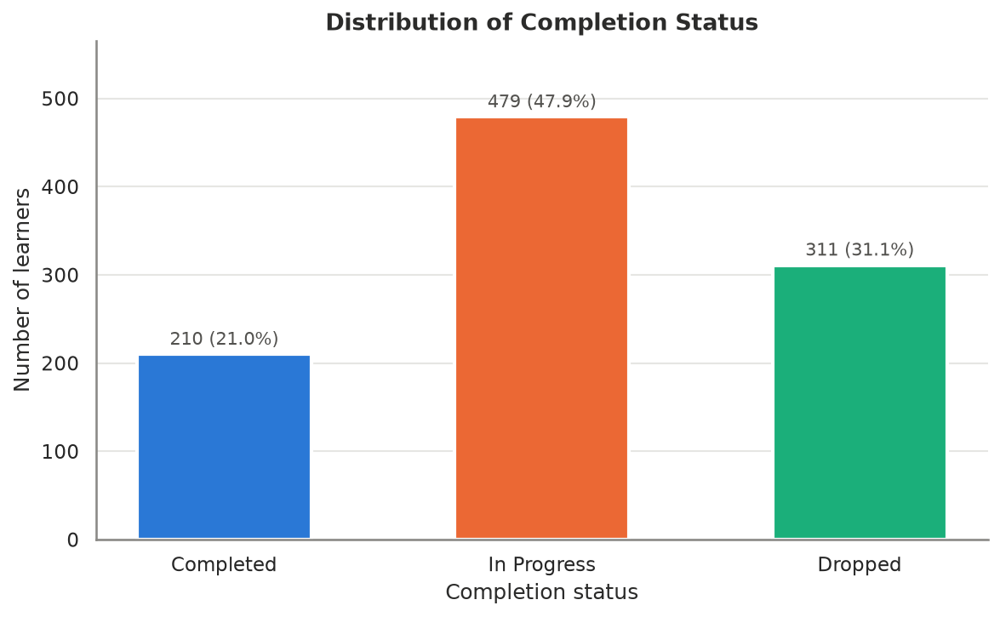
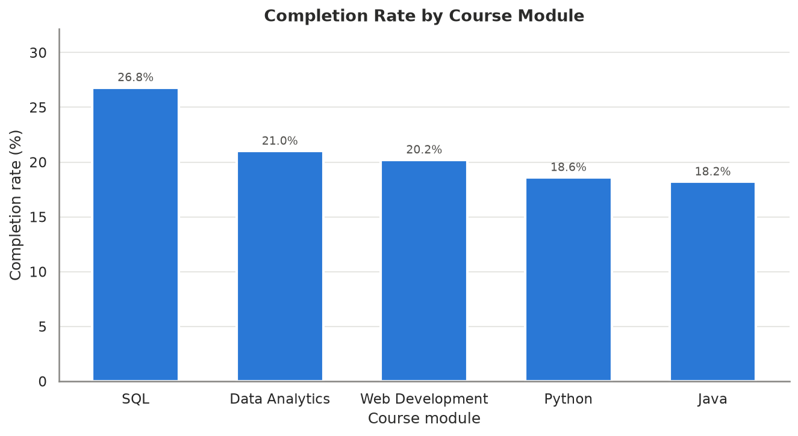
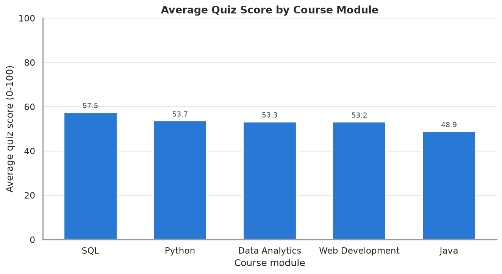
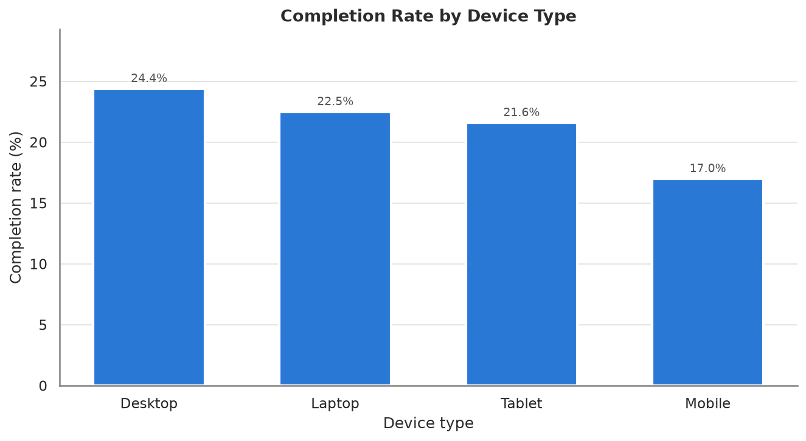
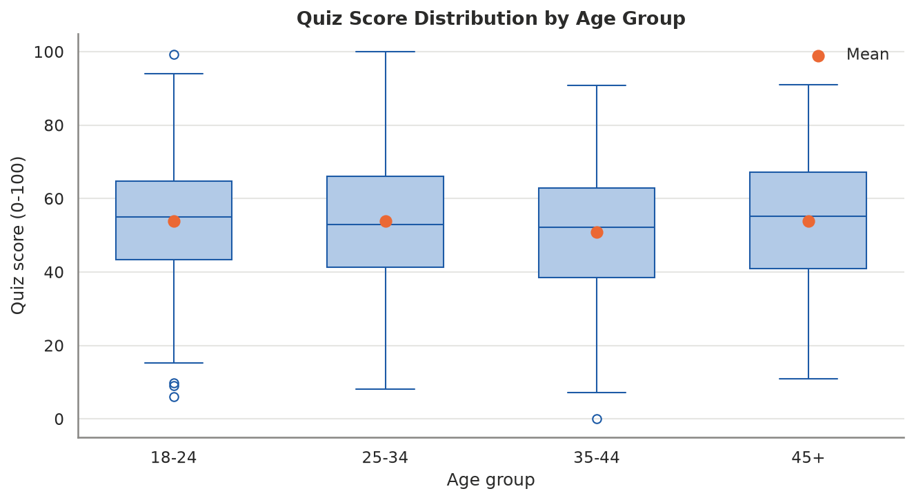
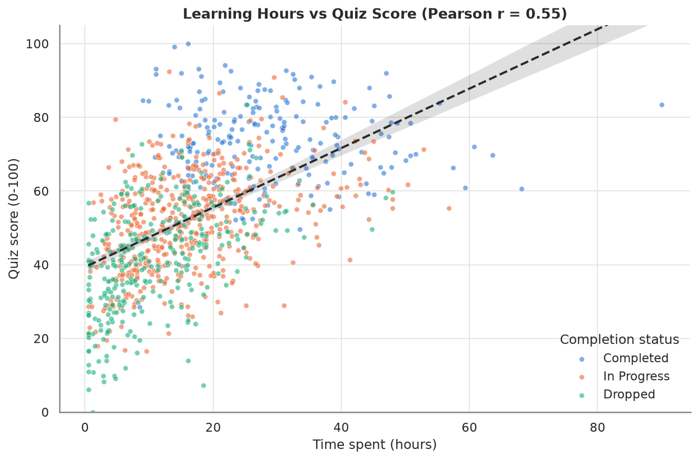
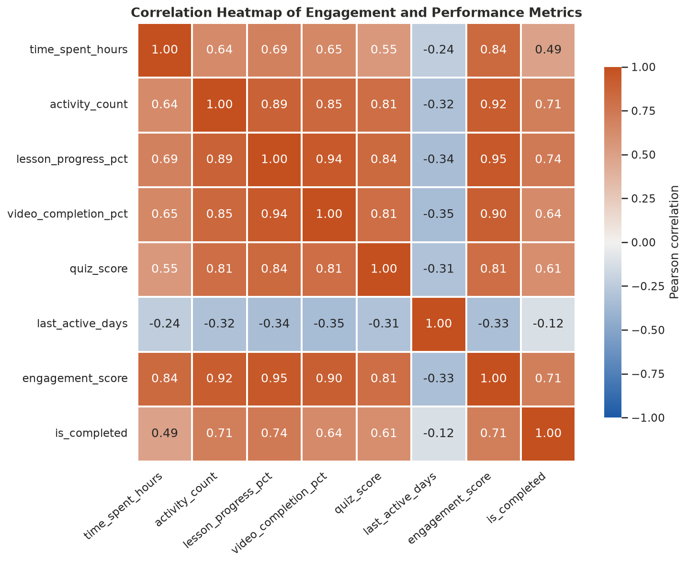
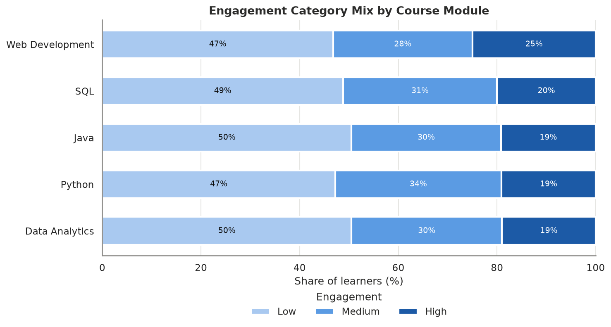

# DA-015: Online Learning Engagement Analysis

**Project type:** Data Analytics (Python, Pandas, NumPy, Matplotlib, Seaborn)  
**Dataset:** Synthetic dataset of 1000 learners (no real personal data)  
**Report generated:** 2026-11-04

## Abstract


This project analyses the engagement and performance of 1000 online learners across five course modules (Python, Java, SQL, Web Development and Data Analytics). After cleaning a raw dataset of 1012 records, exploratory data analysis showed an overall completion rate of 21.0% and an average quiz score of 53.3. A transparent engagement score combining activity, learning time and lesson progress was defined. SQL had the highest and Java the lowest completion rate, and higher engagement was clearly associated with higher completion and quiz performance. Evidence-based recommendations are proposed to reduce dropout.

## 1. Introduction

Online learning platforms collect detailed activity data, but high enrolment does not guarantee that learners stay engaged or finish their courses. Understanding which behaviours relate to completion and performance helps course designers and instructors intervene early.

### 1.1 Objectives
1. Prepare a clean, reliable learner-activity dataset.
2. Measure overall completion, quiz performance and learning time.
3. Compare performance across modules, devices and age groups.
4. Define a transparent engagement score and category.
5. Identify relationships between engagement and outcomes.
6. Provide data-driven recommendations.

## 2. Dataset Description

The dataset is **synthetic** (generated with NumPy using a fixed random seed of 42) and contains no real student information. Behaviours were simulated so that they relate to each other realistically, and data-quality problems (missing activity records, duplicates, invalid scores, inconsistent labels) were deliberately included to demonstrate data cleaning.

### 2.1 Data Dictionary

| column | source | data_type | description | valid_values |
| --- | --- | --- | --- | --- |
| learner_id | Raw | Text | Artificial unique learner identifier (no personal data) | L0001 - L1000 |
| age_group | Raw | Category | Learner age band | 18-24, 25-34, 35-44, 45+ |
| course_module | Raw | Category | Course module enrolled in | Python, Java, SQL, Web Development, Data Analytics |
| device_type | Raw | Category | Main device used for learning | Laptop, Mobile, Desktop, Tablet |
| time_spent_hours | Raw | Decimal | Total learning time on the platform (hours) | >= 0 |
| videos_watched | Raw | Integer | Number of course videos watched | 0 - videos_available |
| videos_available | Raw | Integer | Number of videos in the module | > 0 |
| lessons_completed | Raw | Integer | Number of lessons completed | 0 - lessons_available |
| lessons_available | Raw | Integer | Number of lessons in the module | > 0 |
| quiz_score | Raw | Decimal | Average quiz score (%) | 0 - 100 |
| completion_status | Raw | Category | Course status | Completed, In Progress, Dropped |
| activity_count | Raw | Integer | Platform interactions (logins, posts, submissions) | >= 0 |
| last_active_days | Raw | Integer | Days since the learner was last active | >= 0 |
| video_completion_pct | Derived | Decimal | videos_watched / videos_available x 100 | 0 - 100 |
| lesson_progress_pct | Derived | Decimal | lessons_completed / lessons_available x 100 | 0 - 100 |
| is_completed | Derived | 0/1 | 1 if completion_status == Completed | 0, 1 |
| is_inactive | Derived | 0/1 | 1 if last_active_days > 30 | 0, 1 |
| engagement_score | Derived | Decimal | Weighted score of normalised activity, time and lesson progress | 0 - 100 |
| engagement_category | Derived | Category | Low (<40), Medium (40-69.9), High (>=70) | Low, Medium, High |

## 3. Methodology

1. **Data collection / generation** - `src/generate_data.py` (reuses `dataset/online_learning.csv` if present).
2. **Data cleaning** - `src/data_cleaning.py`: category standardisation, duplicate removal, validation of score ranges, capping impossible values and module-median imputation.
3. **Feature engineering** - `src/engagement.py`: lesson progress %, video completion %, inactivity flag, engagement score and category.
4. **Exploratory data analysis** - `src/analysis.py`: KPIs, group summaries and Pearson correlations.
5. **Visualisation** - `src/visualization.py`: eight PNG charts.
6. **Insight generation** - `src/insights.py`: findings and recommendations built from computed values.

## 4. Data Cleaning Results

- Raw dataset: 1012 rows x 13 columns
- Missing values in raw data: time_spent_hours=32, activity_count=50, last_active_days=20
- course_module: standardised 8 inconsistent label(s); 0 unrecognised value(s)
- device_type: standardised 8 inconsistent label(s); 0 unrecognised value(s)
- completion_status: standardised 8 inconsistent label(s); 0 unrecognised value(s)
- age_group: standardised 0 inconsistent label(s); 0 unrecognised value(s)
- Removed 12 exact duplicate row(s)
- Removed 0 additional duplicate learner_id row(s)
- quiz_score: 6 invalid value(s) outside 0-100 set to missing (values: [-12.0, -5.0, 101.5, 105.0, 120.0, 150.0])
- lessons_completed: 4 value(s) greater than lessons_available capped
- videos_watched: 0 value(s) greater than videos_available capped
- time_spent_hours: imputed 30 missing value(s) with module-level median
- quiz_score: imputed 6 missing value(s) with module-level median
- activity_count: imputed 50 missing value(s) with module-level median
- last_active_days: imputed 20 missing value(s) with module-level median
- Cleaned dataset: 1000 rows; remaining missing values = 0
- Saved cleaned data -> dataset/online_learning_cleaned.csv

## 5. Exploratory Data Analysis

### 5.1 Key Performance Indicators

| Metric | Value |
| --- | --- |
| Total learners | 1000 |
| Completed learners | 210 |
| Completion rate | 21.0% |
| Dropout rate | 31.1% |
| Average quiz score | 53.3 |
| Total learning hours | 17,255.6 |
| Average learning hours | 17.3 |
| Average lesson progress | 57.1% |
| Average activity count | 51.4 |
| Average engagement score | 43.0 |
| Inactive > 30 days | 375 (37.5%) |

### 5.2 Completion Status

| completion_status | learners | percent |
| --- | --- | --- |
| Completed | 210 | 21.0 |
| In Progress | 479 | 47.9 |
| Dropped | 311 | 31.1 |



*Figure: Distribution of completion status*


### 5.3 Module-wise Performance

| course_module | learners | completion_rate_pct | avg_quiz_score | avg_hours | avg_lesson_progress_pct | avg_activity | avg_engagement_score | dropout_rate_pct |
| --- | --- | --- | --- | --- | --- | --- | --- | --- |
| SQL | 205 | 26.8 | 57.5 | 14.0 | 61.9 | 53.6 | 42.9 | 34.6 |
| Data Analytics | 210 | 21.0 | 53.3 | 15.7 | 57.5 | 52.1 | 42.4 | 31.9 |
| Web Development | 188 | 20.2 | 53.2 | 21.3 | 55.9 | 50.7 | 45.5 | 29.8 |
| Python | 199 | 18.6 | 53.7 | 17.9 | 57.3 | 50.1 | 43.1 | 31.7 |
| Java | 198 | 18.2 | 48.9 | 17.8 | 52.7 | 50.3 | 41.5 | 27.3 |



*Figure: Completion rate by course module*




*Figure: Average quiz score by course module*


### 5.4 Device Analysis

| device_type | learners | completion_rate_pct | avg_quiz_score | avg_hours | avg_lesson_progress_pct | avg_activity | avg_engagement_score | dropout_rate_pct |
| --- | --- | --- | --- | --- | --- | --- | --- | --- |
| Desktop | 172 | 24.4 | 54.3 | 18.3 | 60.1 | 52.8 | 45.6 | 23.3 |
| Laptop | 422 | 22.5 | 53.3 | 17.4 | 59.2 | 52.0 | 44.2 | 29.9 |
| Tablet | 88 | 21.6 | 53.3 | 17.9 | 55.0 | 51.2 | 42.6 | 35.2 |
| Mobile | 318 | 17.0 | 52.8 | 16.3 | 53.3 | 49.9 | 40.2 | 35.8 |



*Figure: Completion rate by device type*


### 5.5 Age-group Analysis

| age_group | learners | completion_rate_pct | avg_quiz_score | avg_hours | avg_lesson_progress_pct | avg_activity | avg_engagement_score | dropout_rate_pct |
| --- | --- | --- | --- | --- | --- | --- | --- | --- |
| 18-24 | 385 | 20.5 | 53.9 | 17.8 | 57.4 | 51.5 | 43.7 | 31.9 |
| 25-34 | 311 | 24.4 | 53.8 | 17.7 | 58.7 | 52.3 | 44.2 | 30.5 |
| 35-44 | 186 | 18.3 | 50.8 | 15.8 | 53.4 | 49.1 | 39.9 | 33.3 |
| 45+ | 118 | 17.8 | 54.0 | 16.8 | 57.6 | 52.2 | 42.6 | 26.3 |



*Figure: Quiz score distribution by age group*


### 5.6 Learning Time vs Performance



*Figure: Learning hours vs quiz score*


### 5.7 Correlation Analysis

| index | time_spent_hours | activity_count | lesson_progress_pct | video_completion_pct | quiz_score | last_active_days | engagement_score | is_completed |
| --- | --- | --- | --- | --- | --- | --- | --- | --- |
| time_spent_hours | 1.0 | 0.64 | 0.69 | 0.65 | 0.55 | -0.24 | 0.84 | 0.49 |
| activity_count | 0.64 | 1.0 | 0.89 | 0.85 | 0.81 | -0.32 | 0.92 | 0.71 |
| lesson_progress_pct | 0.69 | 0.89 | 1.0 | 0.94 | 0.84 | -0.34 | 0.95 | 0.74 |
| video_completion_pct | 0.65 | 0.85 | 0.94 | 1.0 | 0.81 | -0.35 | 0.9 | 0.64 |
| quiz_score | 0.55 | 0.81 | 0.84 | 0.81 | 1.0 | -0.31 | 0.81 | 0.61 |
| last_active_days | -0.24 | -0.32 | -0.34 | -0.35 | -0.31 | 1.0 | -0.33 | -0.12 |
| engagement_score | 0.84 | 0.92 | 0.95 | 0.9 | 0.81 | -0.33 | 1.0 | 0.71 |
| is_completed | 0.49 | 0.71 | 0.74 | 0.64 | 0.61 | -0.12 | 0.71 | 1.0 |



*Figure: Correlation heatmap*


## 6. Engagement Score Model

The engagement score is a weighted sum of three robust min-max normalised (0-1) behaviours:

```
engagement_score = 100 x (0.35 x activity_count_norm
                        + 0.35 x time_spent_hours_norm
                        + 0.3 x lesson_progress_pct_norm)
```

Normalisation: each value is clipped to its 5th-95th percentile range, then `x_norm = (x - P5) / (P95 - P5)`, so a few extreme learners do not compress everyone else. Categories: **Low** < 40, **Medium** 40-69.9, **High** >= 70. Activity and time are weighted equally as measures of effort; lesson progress measures results of that effort. Quiz score and completion are deliberately **excluded** so the score can be tested against those outcomes without circular reasoning.

### 6.1 Outcomes by Engagement Category

| engagement_category | learners | avg_engagement_score | completion_rate_pct | avg_quiz_score | avg_hours | inactive_pct |
| --- | --- | --- | --- | --- | --- | --- |
| Low | 488 | 19.5 | 0.2 | 41.5 | 9.1 | 48.6 |
| Medium | 308 | 53.7 | 12.3 | 59.1 | 20.0 | 24.4 |
| High | 204 | 83.3 | 83.8 | 73.0 | 32.5 | 30.9 |

### 6.2 Engagement Mix by Module (% of learners)

| course_module | Low | Medium | High |
| --- | --- | --- | --- |
| Data Analytics | 50.5 | 30.5 | 19.0 |
| Java | 50.5 | 30.3 | 19.2 |
| Python | 47.2 | 33.7 | 19.1 |
| SQL | 48.8 | 31.2 | 20.0 |
| Web Development | 46.8 | 28.2 | 25.0 |



*Figure: Engagement category mix by module*


## 7. Key Insights

1. **Overall performance:** 1000 learners were analysed. The overall completion rate is 21.0%, 47.9% are still in progress and 31.1% have dropped out. The average quiz score is 53.3 and learners spent 17.3 hours on average (17,255.6 hours in total).
2. **Module gap:** SQL has the highest completion rate (26.8%) and Java the lowest (18.2%), a gap of 8.6 percentage points. Average quiz scores range from 48.9 (Java) to 57.5 (SQL).
3. **Learning time and scores:** time spent shows a moderate positive correlation with quiz score (r = 0.55); lesson progress vs quiz score has r = 0.84. More study time is associated with better results, but it does not explain all of the variation.
4. **Activity and completion:** activity count correlates with completion at r = 0.71. High-engagement learners complete at 83.8% versus 0.2% for low-engagement learners, and score 73.0 vs 41.5 on quizzes.
5. **Device effect:** Desktop users have the highest completion rate (24.4%), while Mobile users have the lowest (17.0%) and a dropout rate of 35.8%.
6. **Age groups:** the 45+ group has the highest average quiz score (54.0) and 35-44 the lowest (50.8). The difference is 3.2 points, so age is a minor factor compared with engagement.
7. **Inactivity risk:** 375 learners (37.5%) have not been active for more than 30 days; 304 of them have not completed their course. Days since last activity correlates with completion at r = -0.12.
8. **Engagement distribution:** 48.8% of learners fall in the Low engagement category (average engagement score overall = 43.0).

## 8. Recommendations

1. **Re-engagement campaign:** send automated reminders / mentor check-ins to learners inactive for more than 30 days - this targets 304 learners who have not completed.
2. **Review the Java module:** it has the lowest completion rate (18.2%). Break long lessons into shorter units, add practice exercises and revisit the difficulty curve; use SQL as a design benchmark.
3. **Improve the Mobile experience:** Mobile learners complete less often (17.0% vs 24.4% on Desktop). Optimise video length, offline access and quiz layout for this device.
4. **Early-warning dashboard:** use the engagement score as a weekly risk flag - learners in the Low category (48.8% of the cohort) should be contacted before they drop out.
5. **Targeted quiz support for Java:** it has the lowest average quiz score (48.9); add worked examples, hints and retry-based practice quizzes.
6. **Encourage regular activity:** because activity count and learning time are positively linked to completion and scores, introduce streaks, discussion prompts and weekly goals that reward consistent participation.
7. **Assessment quality check:** 2 learners completed their course with a quiz score below 50 - consider a minimum score requirement or extra revision before completion.

## 9. Limitations

- The data is synthetic; patterns reflect the simulation assumptions and should be validated on real platform data before making decisions.
- Correlation does not imply causation - e.g. motivated learners may both study longer and score higher.
- Missing values were imputed with module medians, which slightly reduces variance.
- Lesson progress is both part of the engagement score and closely tied to completion, so part of the completion gap between engagement categories is structural; the quiz-score gap is the cleaner test.
- The engagement weights are a transparent, reasoned choice rather than statistically optimised.

## 10. Conclusion

The analysis shows that engagement behaviours - activity, learning time and lesson progress - are closely linked to course completion and quiz performance. With a completion rate of 21.0% and 37.5% of learners inactive for over 30 days, the platform should focus on early identification of low-engagement learners, improving the Java module and the Mobile learning experience. The modular Python pipeline makes the analysis fully reproducible.
